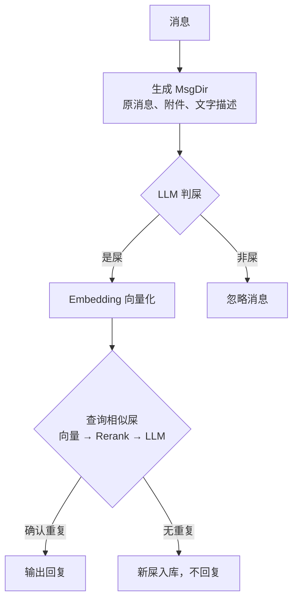

# AstrBot 搬屎查重插件

`astrbot_plugin_shit_duplication_detector` 可以充当 QQ 群中的“搬屎查重机器人”，在群消息中检测重复内容，并在确认重复后生成动态吐槽。

## 使用

1. 在 AstrBot 中创建 OneBot v11 bot，并接入你目前已有的基于 QQ 实体号的 OneBot。
2. 将插件放在 `data/plugins/`，在 AstrBot 中加载本插件。

插件目前仅支持 OneBot v11 协议且仅在群消息中工作。

## 处理规则



## 本地数据

```text
data/plugin_data/astrbot_plugin_shit_duplication_detector/
└── group-<群ID>/
    └── msg-<记录ID>/
        ├── description.json
        ├── message.json
        ├── record.json
        └── attachments/
            └── <链接中的文件名>
```
